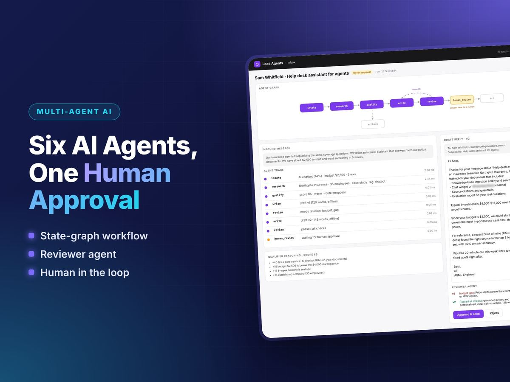
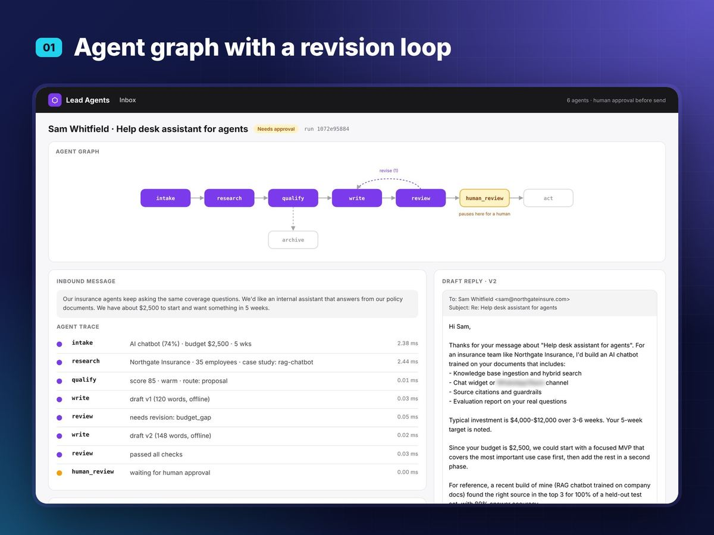
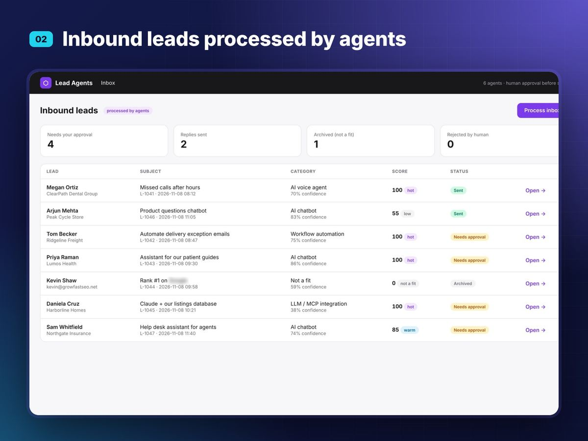
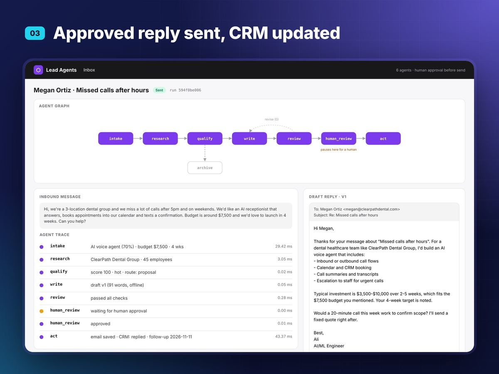
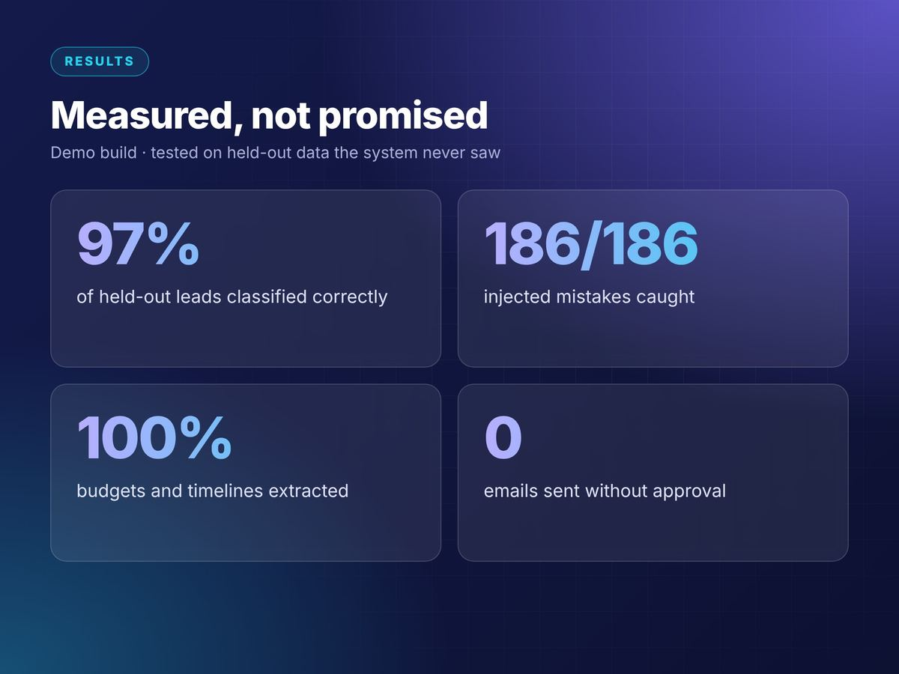

# Multi-Agent AI Workflow Automation

<p align="center"></p>

Six AI agents turn inbound leads into reviewed, personalised replies. A human approves every reply before it is sent.

```
intake -> research -> qualify --(not a fit)--> archive
                         \--> write <-> review (max 2 revisions) -> human_review [pause] -> act
```

| Agent | Job |
|---|---|
| intake | ML classifier (TF-IDF + logistic regression) picks the service line; extracts budget and timeline |
| research | Company profile from enrichment data; picks the most relevant case study |
| qualify | 0-100 score with reasons; routes to proposal, polite decline or archive |
| write | Drafts the reply from a fact sheet. GPT when `OPENAI_API_KEY` is set, deterministic offline otherwise |
| review | Grounding of prices/timelines, no guarantees, personalisation, call-to-action, length; loops back to write |
| act | After approval: saves the .eml, updates the CRM table, schedules a follow-up in 3 business days |

The orchestration engine (`agentflow/graph.py`) is a small LangGraph-style state graph: nodes, conditional routers,
interrupts, SQLite checkpoints (`agentflow/checkpoint.py`) and a per-step trace.

## Run
```bash
pip install -r requirements.txt
python web/app.py                      # console on http://localhost:8200, click "Process inbox"
python scripts/run_inbox.py            # same from the command line
python scripts/run_inbox.py approve <run_id>
pytest tests -q                        # 18 tests
python eval/run_eval.py                # held-out evaluation -> eval/results.json
```
LLM mode: `export OPENAI_API_KEY=sk-...` (and optionally `OPENAI_MODEL`). Results below are from offline mode.

## Results (36 held-out leads, offline mode)
- Intake classification: 35/36 (97.2%), macro F1 0.972
- Budget and timeline extraction: 36/36 each
- Reviewer: 186/186 injected mistakes caught. The first evaluation run caught 180/186: the call-to-action check
  was fooled by drafts that mention "call flows"; the check now looks only at the closing paragraph.
- 0 emails sent without approval

## Data
`data/` holds sample data: fictional companies and leads, `pricing.json` (edit to your own rates) and
`case_studies.json` (your own projects). Training (72) and test (36) leads are separate files.

## Screenshots

| | |
|---|---|
|  |  |
|  |  |
